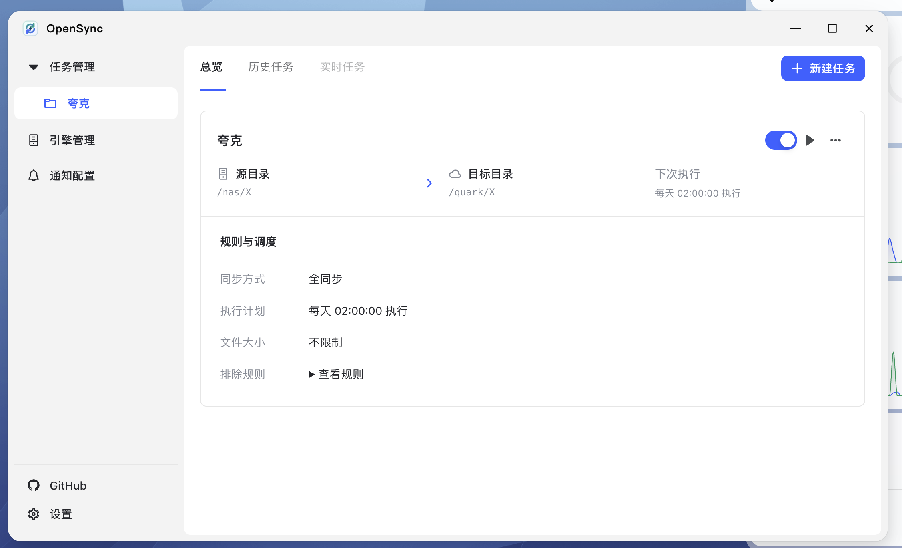
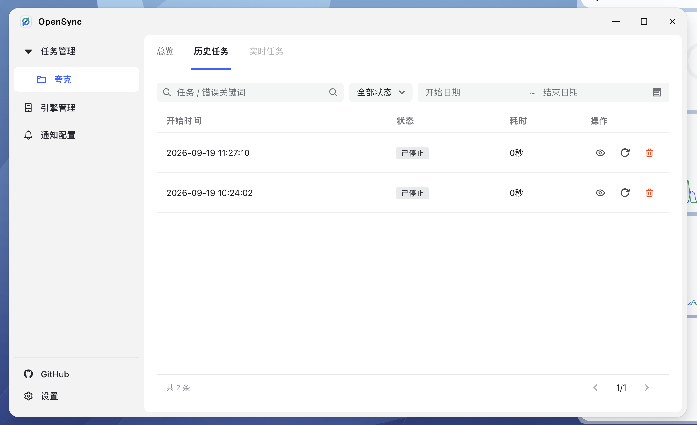
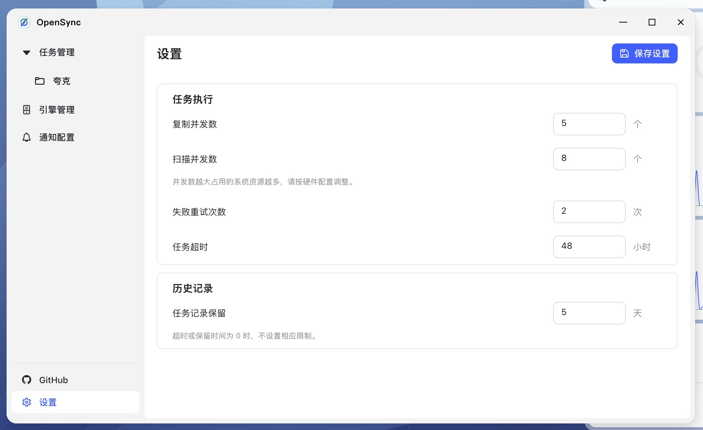

<div align="center">

# OpenSync

**飞牛 NAS 上的自动同步与备份工具**

把 NAS、网盘和 WebDAV 之间的文件同步交给它：持续同步或定时执行、进度可见、结果有通知。

群晖 Cloud Sync 的免费开源替代方案

[](https://github.com/chenbin3625/OpenSync-fnOS/releases)
[](https://github.com/chenbin3625/OpenSync-fnOS/releases)
[](LICENSE)

当前版本：**v0.0.52**

[下载安装](https://github.com/chenbin3625/OpenSync-fnOS/releases/latest) · [快速上手](#快速上手) · [常见问题](#常见问题)

</div>

OpenSync 是运行在飞牛 fnOS 上的文件同步与备份应用，基于内置 `rclone` 引擎驱动。安装后即可直接在飞牛本地授权目录与各类对象存储、网盘及网络协议（夸克网盘原生驱动、S3、WebDAV、SFTP、SMB、FTP、OneDrive、Google Drive、Dropbox、Backblaze B2、Azure、GCS、Crypt 加密存储等）之间自动同步与备份文件。

**夸克网盘**已提供内置原生驱动，支持夸克 App 扫码登录与手动 Cookie、`__puus` 自动续期以及本地上传秒传/分片直传；如需同步阿里云盘、百度网盘、115 等其他国内网盘，可通过「存储管理 → 添加远程存储」中的 **OpenList / AList (WebDAV)** 快捷模板接入自建 OpenList / AList 服务的 WebDAV 地址。

## 目录

- [它能做什么](#它能做什么)
- [功能一览](#功能一览)
- [安装](#安装)
- [快速上手](#快速上手)
- [同步模式怎么选](#同步模式怎么选)
- [文件夹同步路径规则](#文件夹同步路径规则)
- [文件过滤](#文件过滤)
- [任务状态与通知](#任务状态与通知)
- [系统设置](#系统设置)
- [常见问题](#常见问题)
- [更新与反馈](#更新与反馈)

## 它能做什么

- **照片和视频备份** —— 把 NAS 上的相册目录每天自动备份到阿里云盘、百度网盘或 OneDrive，多一份云端保险。
- **重要资料容灾** —— 工作文档、家庭资料定时镜像到另一块硬盘或另一个网盘，硬盘坏了也不慌。
- **网盘搬家** —— 把旧网盘的文件搬到新网盘，确认复制成功且内容校验无误后，再删除源文件。
- **多端保持一致** —— 让目标目录和源目录完全一致，源端删掉的文件，目标端也会同步删除。
- **执行结果随时掌握** —— 成功、部分失败、失败都会推送通知，不用天天盯着进度条。

适合这些用户：

- 有飞牛 NAS，想给重要数据多做一份云端备份；
- 文件散落在多个网盘，想集中整理和搬运；
- 习惯群晖 Cloud Sync 的用法，希望在飞牛上找到同类工具；
- 不想折腾脚本，只想在图形界面里点几下完成配置。

## 功能一览

| 能力 | 说明 |
| --- | --- |
| 运行仪表盘与批量管理 | KPI 概览、近 7 天统计、全局待审批横幅、按存储/模式/状态筛选、批量操作与复制任务 |
| 四种同步方式与模拟校验 | 增量同步、全量同步、移动、双向同步（rclone bisync）；支持只读模拟运行（Dry-Run）与数据一致性校验（check / cryptcheck） |
| 灵活定时与排队控制 | 固定间隔、Cron 表达式、仅手动触发、允许运行时间窗口、全局与按存储并发控制、限速（`--bwlimit`）与单任务调优覆盖 |
| 精细比对与文件过滤 | 黑/白名单过滤、大小/时间/稳定期/文件夹/系统目录过滤与规则测试器；自定义比对与同名冲突策略 |
| 实时进度与执行历史 | 实时速度与逐文件进度；历史明细支持 CSV/TXT 导出、精准单条/勾选重试与批量删除 |
| 12 种通知渠道与存储巡检 | 钉钉、企业微信、企业微信群机器人、飞书、Server酱、Bark、Telegram、SMTP 邮件、ntfy、Gotify、PushPlus、Webhook；支持事件过滤、模板变量、任务级绑定及存储连通性告警 |
| 数据安全与运维工具 | 全量删除保护与审批超时、目标端回收站（软删除）、移动校验后删源、远端浏览与恢复、配置备份恢复与在线日志查看 |

## 安装

### 安装前准备

- 飞牛 fnOS **1.2.0401 或更高版本**；
- 在飞牛「应用设置 → 文件夹访问权限」中为 OpenSync 授予需要同步的本地文件夹读写权限；
- 如需接入国内网盘，可配合自建 [OpenList](https://github.com/OpenListTeam/OpenList) / AList 的 WebDAV 服务使用。

### 下载安装包

| 设备架构 | 安装包 |
| --- | --- |
| x86 / amd64（Intel、AMD） | [opensync-amd64.fpk](https://github.com/chenbin3625/OpenSync-fnOS/releases/latest/download/opensync-amd64.fpk) |
| ARM / arm64 | [opensync-arm64.fpk](https://github.com/chenbin3625/OpenSync-fnOS/releases/latest/download/opensync-arm64.fpk) |

不确定设备架构？在飞牛的系统信息中查看处理器型号：Intel、AMD 选 amd64，ARM 处理器选 arm64。也可以前往 [Releases](https://github.com/chenbin3625/OpenSync-fnOS/releases) 查看全部版本。

### 安装步骤

1. 在飞牛中打开「应用中心」，选择「手动安装」，上传下载好的 `.fpk` 文件。
2. 等待安装完成，在应用列表中找到 **OpenSync** 并打开。
3. 在飞牛「应用设置 → 文件夹访问权限」中为 OpenSync 授权需要访问的本地目录。

安装包同时提供 `SHA256SUMS` 校验文件，熟悉命令行的用户可以自行校验完整性。

## 快速上手

下面以「把 NAS 上的照片备份到云端或另一块磁盘」为例，第一次配置只需几分钟。

### 第 1 步：配置本地目录与远程存储

1. 在飞牛应用设置中给 **OpenSync** 授权需要同步的本地文件夹（如需本地磁盘间互备，同时授权源和目标文件夹）。
2. 打开 OpenSync，进入「**存储管理**」：
   - 页面默认展示 **本地目录** 卡片，显示已授权的本地路径与 `rclone` 状态；点击「**配置本地目录**」可刷新授权目录列表、修改备注与全局并发上限。
   - 点击「**添加远程存储**」直接添加 S3（阿里云 OSS / 腾讯云 COS / Cloudflare R2 / MinIO / AWS / B2 等）、WebDAV、SFTP、SMB、FTP、OneDrive、Google Drive、Dropbox、Crypt 加密存储等；也可点击「**导入配置**」直接导入现有 `rclone.conf`（支持明文与加密配置）。
   - **通过 OpenList / AList 接入国内网盘**：在「添加远程存储」表单中点击 **OpenList / AList (WebDAV)** 快捷模板，填写 WebDAV 地址（同机通常为 `http://127.0.0.1:5244/dav`）和账号密码，测试连接正常后保存即可。
3. 保存后，每个远程存储都会以独立卡片展示在「存储管理」列表中，支持一键测试连接、浏览与恢复文件、查看空间配额、清理回收站、重命名与编辑。

S3 和 QingStor 可选择显式密钥、运行时凭据或匿名访问。运行时凭据由应用环境提供（如 `AWS_ACCESS_KEY_ID` / `AWS_SECRET_ACCESS_KEY`、`RCLONE_QINGSTOR_ACCESS_KEY_ID` / `RCLONE_QINGSTOR_SECRET_ACCESS_KEY`）。OCI 用户主体认证需在应用环境设置 `RCLONE_OOS_CONFIG_FILE` 的绝对路径，可用 `RCLONE_OOS_CONFIG_PROFILE` 选择配置节；OCI 配置中的私钥文件也应使用绝对路径。实例主体认证适用于已获授权的 OCI 实例。

导出的 `rclone.conf` 会将本地底层目录转换为当前 NAS 的绝对路径，迁移设备后需调整这些路径；运行时凭据需在新设备另行配置。通过 URL 拉取文件仅接受公共 HTTP/HTTPS 地址，下载及重定向都会检查实际连接地址；通过 HTTP 代理拉取 HTTP 链接时，代理需允许 CONNECT 到目标端口。

### 第 2 步：新建同步任务

进入「任务管理」，点击「新建任务」，按三个步骤配置（前两步即可直接保存，第 3 步按需选填）：

1. **基础与路径** —— 填写任务名称、选择同步方式（增量同步 / 全量同步 / 移动 / 双向同步），并从目录树选择源路径与目标路径（也可手动输入 `/存储名称/桶名/子目录`）。下方会实时展示**同步位置预览**与跨任务冲突检查；若目标存储选用 OpenList / AList 等标准 WebDAV，任务会自动默认使用 **仅按文件大小** 比对，避免拉取大量远端资源到本地校验。
2. **执行计划** —— 选择定时计划（支持每天 / 每周 / 每月快捷预设或自定义 Cron）、固定间隔（支持分钟 / 小时 / 天）或仅手动触发，实时预览接下来的预计执行时间；「高级选项」支持带宽限速（`--bwlimit`）、API 流控（`--tpslimit`）、多线程分流、`--fast-list` 等 rclone 调优参数。填写完成后可直接点击「保存」，也可勾选「创建后立即执行一次」。
3. **过滤规则（可选）** —— 按需设置黑白名单、文件大小与时间范围、文件类型/自定义规则、源目录子文件夹排除以及 macOS、Windows、NAS 回收站等系统目录过滤，并可用内置测试器验证匹配效果。

保存后会自动定位到新建任务，并按计划自动执行。

> 不熟悉 Cron？定时计划可直接点选「每天 / 每周 / 每月」预设，或切到「固定间隔」按分钟 / 小时 / 天设置，下方卡片会实时展示接下来 3 次预计执行时间。

### 第 3 步：模拟预览并手动跑一次

建议第一次先点击「模拟运行预览（只读）」或手动执行一次，确认路径和过滤规则符合预期：

1. 在任务「总览」中点击「立即执行」。
2. 切换到「实时任务」查看进度、速度和逐文件状态。
3. 执行完成后，在「历史任务」中核对成功和失败的文件数量，或点击「数据一致性校验」核验两端文件一致性。

<p align="center">
  
</p>

<p align="center">
  
</p>

<p align="center">
  
</p>

### 第 4 步：配置通知（可选）

进入「通知配置」，添加你常用的通知渠道，填写必要参数后点击「测试」确认能收到消息。之后任务执行结束，结果会自动推送到对应渠道。

<p align="center">
  
</p>

## 持续同步

新建任务默认使用「持续同步」，也可以在「执行计划」切回固定间隔、Cron 或仅手动。已有任务的运行方式保持不变。

- **方向与删除分开设置**：上传使用本地源目录和远端目标目录，下载使用远端源目录和本地目标目录；自定义单向支持本地互备或网盘之间同步。开启「同步删除」会沿用镜像模式的删除保护、审批和回收站。双向同步会传播两端的变更和删除，新选双向时默认保留冲突副本。
- **自动检测**：本地授权目录自动监听（双向时覆盖两端本地目录）；检测失败或目录过多时回退到本地轮询。远端默认每 60 秒检测一次，可设置为 10–86400 秒；默认每 1440 分钟进行完整核对，可设置为 1–10080 分钟。
- **恢复与重试**：待同步变更和检测索引保存在数据库中，重启、暂停后恢复、运行窗口重新开放时补跑。传输失败会保留待处理记录，并按 10 秒至 1 小时的退避间隔重试。任务总览和仪表盘展示监控、扫描、同步、已同步、窗口等待、异常与待重建状态。
- **按变更传输**：已知新增或修改的文件按所属源目录处理，支持多源映射；只刷新受影响的父目录并复用文件清单传输。已知的同大小修改即使与完整核对合并也会补传。删除、目录结构变化和事件溢出会回到完整计划，以保留原有安全检查。
- **双向基线保护**：首次双向同步自动初始化；成功初始化后，两端清单缺失或相关任务／存储身份改变会停止自动执行。请核对两端数据，再在任务菜单明确选择「重建双向基线」。

远端检测目前采用兼容各存储的目录轮询，检测成本随文件数增长，尚未接入各网盘专属的变更日志接口。普通 WebDAV 通常缺少可靠修改时间和哈希，未被本地监听捕获的同大小修改仍可能漏检；选择内容校验可在完整核对时检查内容，但会增加流量。文件级同步会重新传输修改后的整个文件，不是块级增量。

## 同步模式怎么选

| 模式 | 一句话说明 | 目标端多余文件 | 源文件 | 推荐场景 |
| --- | --- | --- | --- | --- |
| **增量同步** | 只复制新增和内容变化的文件 | 保留 | 保留 | 日常备份 |
| **全量同步** | 让目标目录与源目录完全一致 | 删除（有保护） | 保留 | 镜像、容灾 |
| **移动** | 复制并校验成功后删除源文件 | — | 校验后删除 | 网盘搬家、腾空间 |
| **双向同步** | 两端互相同步变更（`rclone bisync`） | 同步变更 | 同步变更 | 多端协作、双向镜像 |

### 增量同步

只复制源目录中目标端不存在或内容发生变化的文件，不会删除目标端的任何文件。适合「源端删了文件，但网盘里还想保留一份」的日常备份场景。

这是最稳妥的模式，建议第一次使用、或不确定该选什么时，先从增量同步开始。

### 全量同步

让目标目录与源目录保持完全一致，目标端多出来的文件会被删除。源文件只是换到另一个目录、文件名和内容都没有变化时，会尽量复用目标端已有的相同内容，避免重复上传（改名不会被识别为同一个文件）。

全量同步会先完成本次新增、更新与同端移动，不阻塞同步任务；需要删除确认时（手动全量同步，或开启了「定时全量删除确认」的定时任务），待删除项会后置到待确认清单中，等您确认并经实时复核后再在后台执行删除，不会阻塞同步任务或后续计划执行。当计划删除量异常偏大、目录扫描结果不完整，或源根目录列表为空而目标端仍有内容时，会跳过清理并记录失败。同路径的文件和目录需要先解决类型冲突；如果冲突涉及被排除的目标内容，则保留原内容并报告失败。第一次切换到全量同步前，仍建议先手动执行一次，确认文件列表无误。

### 移动

先把文件复制到目标目录，确认目标文件存在且大小一致、源文件在复制期间没有变化（两端都提供 MD5 时还会比对 MD5），才会删除源文件。适合把文件从一个网盘搬到另一个网盘，或从系统盘挪到数据盘。

移动完成后会保留空源目录，被过滤掉的文件也不会被删除。目标端已经存在同名但内容不同的文件时，不会覆盖它：该文件会记录为失败并保留源文件，等待人工处理。

> **移动模式注意事项**
>
> - 只能设置一个目标目录；
> - 不要使用指向同一份数据的别名、重复挂载或软链接；
> - 移动过程中不要修改两端的文件；
> - 引擎账号需要具备两端目录刷新、目标复制和源文件删除权限；
> - 缺少 MD5 时，大小和修改时间相同并不能 100% 证明内容逐字节一致。有并发写入需求时，建议先使用增量同步并人工验收。

## 文件夹同步路径规则

在新建或编辑任务的「基础与路径」步骤中，选好源路径和目标路径后，下方的**同步位置预览**会实时展示每个源目录最终同步到的目标位置，并高亮自动追加的子目录层级。

不同选择组合的映射规则如下：

| 场景 | 源路径示例 | 目标路径示例 | 实际同步目标位置 | 说明 |
| --- | --- | --- | --- | --- |
| **单个源目录** | `/Photos` | `/Backup` | `/Backup/` | 源目录里的文件和子目录**直接同步到目标目录下**，不会额外创建 `/Backup/Photos/`。例如 `/Photos/a.jpg` 会同步为 `/Backup/a.jpg` |
| **多源 · 有共同父目录（同级）** | `/drive/2`、`/drive/学习` | `/backup` | `/backup/2/`、`/backup/学习/` | 自动省略共同父目录 `/drive`，避免在目标端多套一层父目录 |
| **多源 · 有共同父目录（含深层）** | `/nas/docker`、`/nas/common/sec` | `/google` | `/google/docker/`、`/google/common/sec/` | 只省略最深共同父目录 `/nas`，保留其后的相对目录层级，防止不同分支下的同名目录合并覆盖 |
| **多源 · 无共同父目录（末级不同名）** | `/media/photos`、`/archive/videos` | `/backup` | `/backup/photos/`、`/backup/videos/` | 没有除 `/` 外的共同父目录时，按各源目录的末级文件夹名在目标下建子目录 |
| **多源 · 无共同父目录（末级同名）** | `/a/docs`、`/b/docs`、`/media/photos` | `/backup` | `/backup/a/docs/`、`/backup/b/docs/`、`/backup/photos/` | 末级文件夹同名冲突时，同名项自动保留完整路径以防互相覆盖；不重名项仍只保留末级名称 |
| **多个目标目录** | `/media/photos`、`/archive/videos` | `/b1`、`/b2` | `/b1/photos/`、`/b1/videos/`、`/b2/photos/`、`/b2/videos/` | 每个源目录都会按以上规则分别同步到每一个目标目录（移动模式仅允许一个目标目录） |

### 编辑已有任务时的位置锁定

任务保存后，OpenSync 会记录当前每个「源目录 → 目标目录」的实际落点。之后编辑任务时：

- **只增删源路径、不修改目标路径**：保留下来的源目录会继续**沿用原目标位置**（编辑器预览中会标记「沿用原位置」），新增的源目录按当前选择计算落点。这样可以避免因增删源目录导致共同父目录变化，进而触发整目录重传或在全量同步中误删旧目录。
- **修改目标路径**：一旦目标路径列表发生增删、改动或顺序变化，所有源目录都会按最新规则重新计算目标位置。
- **单源扩成多源的注意事项**：如果原任务是单源直接落到目标根目录（如 `/Photos` → `/Backup/`），在不改目标路径的前提下新增第二个源目录（如 `/Docs` → `/Backup/Docs/`），由于 `/Backup/` 包含 `/Backup/Docs/`，系统会拦截该配置；此时调整目标路径重新分配，或为新目录单独建任务即可。

### 路径冲突限制

为避免同一目录树被并发写入或在全量同步中被误删，以下配置会在预览中提示并禁止保存：

- **源目重叠或互含**：源目录与目标目录不能相同或互相包含（不区分大小写，例如 `/Photos` 与 `/photos` 视为同一目录）；
- **多源互含**：多个源目录之间不能互相包含（如同时选 `/Photos` 和 `/Photos/2024`）；
- **最终目标位置互含**：不仅配置的多个目标目录之间不能互相包含（如 `/Backup` 与 `/Backup/Nightly`），多源推导出的最终落点之间也不能互相包含（例如 `/x/a`、`/y/a`、`/z/x` 同步到 `/D` 会分别落到 `/D/x/a/`、`/D/y/a/` 和 `/D/x/`，其中 `/D/x/` 包含 `/D/x/a/`）；
- **跨任务目标冲突**：同一存储引擎下，不同任务的最终目标位置之间同样不能互相包含。

## 文件过滤

被过滤掉的源文件不会复制；全量同步也不会删除或覆盖被排除规则过滤掉的目标内容。仅因大小范围被跳过的同名目标文件例外：源文件进入范围后会被更新，不再被旧的目标副本挡住。即使目标父目录只在目标端存在，清理时也会保留其中被排除的文件和目录。相关设置位于任务编辑器的「过滤规则」中。

### 按大小过滤

可以分别设置「排除小于」和「排除大于」的文件大小，例如跳过 10 KB 以下的缩略图和 10 GB 以上的超大文件。

### 按文件类型过滤

界面内置了常用分组，勾选即可排除：

- 系统文件：`.DS_Store`、`._*`、`Thumbs.db`、`Desktop.ini` 等；
- 音乐、视频、图像、文档、压缩文件、可执行文件等常见类型。

也可以在下方输入框添加自定义规则，支持简单的 `*` 通配符：

| 规则 | 作用 |
| --- | --- |
| `Thumbs.db` | 忽略所有同名文件 |
| `._*` | 忽略以 `._` 开头的文件 |
| `*.tmp` | 忽略所有 `.tmp` 后缀的文件 |

> 自定义输入只支持文件名和后缀规则，不支持 `!` 反选、字符集、正则表达式等复杂语法，保存时会提示并拒绝不支持的写法。需要忽略文件夹时，请使用下面的「文件夹过滤」。

### 按文件夹过滤

在「文件夹过滤」中展开源目录树，勾选要忽略的子文件夹即可。规则只针对源目录，未勾选的文件夹会正常同步。

### 系统目录过滤

一键忽略常见的系统和 NAS 目录，包括：

- macOS：`.Spotlight-V100/`、`.Trashes/`、`.fseventsd/` 等；
- Windows：`$RECYCLE.BIN/`、`System Volume Information/`；
- NAS 回收站：`#recycle/`、`@Recycle/`、`.Trash/` 等；
- 其他：`lost+found/`、`@eaDir/` 等。

## 任务状态与通知

### 三种查看视图

- **总览** —— 查看任务的引擎、路径、模式和下次执行时间；可以立即执行、停止当前任务、停用任务或编辑配置。
- **实时任务** —— 查看正在执行的任务进度，包括传输速度、已完成大小、运行时间和逐文件状态。页面会定期刷新，切换状态或分页时立即加载。
- **历史任务** —— 按日期范围、状态或任务 ID 筛选执行记录。运行中可点击「查看实时进度」跳转，已结束可查看逐文件明细并按操作类型、对象类型或关键词筛选。

任务状态包括：等待中、运行中、成功、部分失败、失败、已停止、超时、系统错误和无需同步。出现「部分失败」时，可以在历史记录中点击「重试未完成项」。文件失败项可以直接重试；目录失败项会重新扫描对应的源目标目录并比较文件。重试不会重放旧删除，也不会在全量重扫时清理目标端；需要镜像清理时，请重新执行全量同步。

### 通知渠道

支持 12 种通知渠道，均可配置事件过滤（全部事件 / 仅异常·失败·待审批 / 自定义事件）与自定义消息模板变量，并可在任务编辑器的「执行计划」中为单个任务绑定指定通知渠道或关闭通知：

| 渠道 | 适合场景 | 需要准备 |
| --- | --- | --- |
| 钉钉机器人 | 家庭群、团队群 | Webhook 地址，可选加签密钥 |
| 企业微信（应用） | 企业微信成员推送 | CorpID、CorpSecret、AgentID |
| 企业微信群机器人 | 企业微信群 | 群机器人 Webhook 地址 |
| 飞书 / Lark | 团队群 | Webhook 地址，可选签名密钥 |
| Telegram 机器人 | 个人或群组推送 | Bot Token、Chat ID，可选自建 API 地址 |
| SMTP 邮件 | 邮箱通知 | SMTP 服务器、端口、发件人/收件人邮箱与授权码 |
| Server酱 | 微信推送 | SendKey |
| Bark | iPhone 推送 | Device Key，可自建服务器 |
| ntfy | 轻量自托管/移动推送 | Topic 主题，可选自建服务器与 Token |
| Gotify | 自托管推送服务 | 服务器地址与 App Token |
| PushPlus | 微信/多端推送 | Token |
| 自定义 Webhook | 接入自建服务或自动化平台 | URL，支持 GET / POST / PUT |

添加通知后可以先点「测试」确认配置正确。通知是异步发送的，发送失败不会影响任务本身；通知列表会显示最近一次的投递状态。通知内容只包含任务状态、源/目标路径、成功/失败数量、耗时和大小等摘要，不会发送文件内容。

## 系统设置

在「设置」页面可以调整任务执行参数、管理配置备份与查看应用日志：

| 设置项 | 默认值 | 说明 | 调整建议 |
| --- | --- | --- | --- |
| 操作并发数 | 5 | 同时执行的复制、删除、移动操作数量（单个任务可覆盖） | 网盘限速或频繁失败时调低 |
| 扫描并发数 | 16 | 同时扫描源端和目标端目录的请求数量（单个任务可覆盖） | 大目录或接口不稳定时调低 |
| 失败重试次数 | 2 | 单个文件操作失败后的最大重试次数（单个任务可覆盖） | 网络不稳定时可调到 3–5 |
| 任务超时 | 48 小时 | 任务超过该时长后自动标记为超时 | 首次超大同步可调高，`0` 表示不限制 |
| 删除审批超时 | 30 分钟 | 待确认删除清单的有效期，超时自动过期并保留目标端文件（不阻塞同步任务） | `0` 表示永不过期直至手动确认或跳过 |
| 存储健康检查周期 | 15 分钟 | 后台定时探测内置 rclone 与各远程存储在线状态和延迟的周期 | `0` 表示关闭定时巡检 |
| 任务记录保留 | 30 天 | 历史任务记录保留天数 | `0` 表示不自动清理 |

此外，设置页还提供：

- **默认带宽限制与全局代理**：为内置 rclone 统一配置默认 `--bwlimit`（支持分时段限速）与 HTTP/SOCKS5 代理（本地授权目录自动直连）；
- **配置备份与恢复**：一键导出/导入系统设置、存储配置、通知渠道和任务配置的 JSON 备份（默认脱敏密钥，可按需选择包含密钥；导入支持跳过或覆盖同名项）；
- **应用运行日志**：在线按级别、行数和关键词筛选运行日志，自动脱敏敏感凭据，并支持下载完整日志排查问题。

<p align="center">
  
</p>

## 常见问题

### 必须安装 OpenList 吗？能不能直接连网盘？

不需要。OpenSync 内置 `rclone`，开箱即可直接连接本地授权目录、S3（阿里云 OSS / 腾讯云 COS / R2 / MinIO 等）、WebDAV、SFTP、SMB、FTP、OneDrive、Google Drive、Dropbox、Backblaze B2、Crypt 加密存储等。如果需要使用阿里云盘、百度网盘、夸克、115 等国内网盘，可通过「存储管理 → 添加远程存储」中的 **OpenList / AList (WebDAV)** 模板连接自建 OpenList / AList 的 WebDAV 地址。

### 为什么看不到飞牛本地目录？

请在飞牛「应用设置 → 文件夹访问权限」中为 **OpenSync** 授权需要访问的文件夹，然后回到 OpenSync 的「存储管理 → 配置本地目录」点击「刷新目录」即可立即生效。

### 使用 OpenList / AList（WebDAV）同步会拉取大量文件到本地比对吗？

不会。标准 WebDAV（`vendor=other`）通常不支持修改时间与哈希校验，当目标存储为 OpenList / AList 等标准 WebDAV 时，OpenSync 会自动默认使用 **仅按文件大小** 比对（且默认比对模式在执行时也会自动走 `--size-only`），避免触发读回下载校验并大幅节省流量。仅当你手动选择「大小 + MD5」或在一致性校验中勾选 `--download` 时才会下载文件做内容比对。

### 全量同步会不会误删我的文件？

全量同步确实会删除目标端多余的文件，但内置了删除保护：当计划删除量异常偏大、目录扫描不完整，或源根目录列表为空时，会自动跳过删除并记录失败。第一次使用建议先手动执行一次，核对文件列表后再放心交给计划任务。

### 移动模式安全吗？

移动会先复制，再校验目标文件大小、源文件大小和修改时间（两端支持时还会比对 MD5），确认无误后才删除源文件；校验不通过会保留源文件并报告失败。请只设置一个目标目录，不要使用指向同一份数据的别名或软链接，也不要在移动期间修改两端文件。

### 同步速度慢怎么办？

速度主要取决于设备上行带宽、远端存储的接口限速以及并发/分流配置。可在任务「高级选项」中按需调整操作并发数、单文件多线程流数（`--multi-thread-streams`）、`--fast-list` 或限流参数（`--tpslimit` / `--bwlimit`）。

### 任务失败了怎么办？

先到「任务管理 → 历史任务」查看失败原因。常见原因包括远程凭据过期、目录权限不足、网盘限流或网络超时。修复后点击「重试未完成项」即可（支持文件级与目录级重试），已完成的部分不会重复复制。配置了通知的话，任务结束时也会收到结果提醒。

### 任务运行中可以停止吗？

可以。在任务「总览」中点击「停止」只会中止当前这次执行；关闭任务开关则会停用计划并中止当前执行。已经完成的文件不会回滚或撤销。

### 升级会丢失配置和任务吗？

不会。使用新版本安装包覆盖升级会保留存储配置、任务、通知和历史记录，升级前应用还会自动备份数据。升级过程会自动停止并重新启动应用。

### 卸载会删除我同步的文件吗？

不会。卸载只会移除 OpenSync 应用本身，不会删除源目录或目标目录里的文件。应用配置和历史记录保存在飞牛的应用数据目录中，是否保留以飞牛卸载时的提示为准。

### 支持双向同步吗？

支持。新建任务时将同步方式设为 **双向同步**（基于 `rclone bisync`，支持单源对单目标），并在「高级选项」中按需配置首次基线冲突策略与最大删除数保护；若中途发生异常中断，可在任务菜单中点击「重建双向基线（--resync）」恢复。

### 会收集我的隐私数据吗？

不会上传你的文件或网盘账号信息。远程存储密钥和通知凭据都会加密保存在本机；应用只会访问 GitHub 查询公开的最新版本号，以及按你的配置发送任务通知。

## 更新与反馈

### 检查更新

应用会自动查询 GitHub 上的最新正式版本（成功结果缓存 30 分钟）。发现新版本时，版本号旁会出现蓝色升级图标，右上角也会弹出可点击的提醒，点击即可前往 Releases 下载新安装包。

### 问题反馈

遇到问题欢迎到 [GitHub Issues](https://github.com/chenbin3625/OpenSync-fnOS/issues) 反馈。提交时请附上：

- OpenSync 版本号；
- 任务名称和错误提示；
- 如果方便，附上应用数据目录下的 `app.log` 日志。

### 许可证

本项目基于 [MIT License](LICENSE) 开源。

<details>
<summary>本地开发与打包（开发者）</summary>

```bash
npm run dev        # 启动 Go 后端和 Vite 前端
npm run dev:mock   # 仅调试前端，使用内置 mock 数据
npm run package:amd64
npm run package:arm64
```

技术栈：React 19 + TypeScript + Vite + Semi Design，后端 Go + Gin + SQLite，使用 robfig/cron 调度，按 fnOS Native App 规范打包。

</details>
