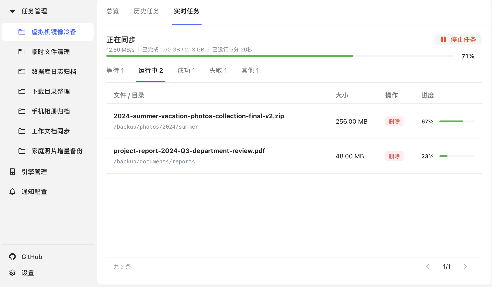
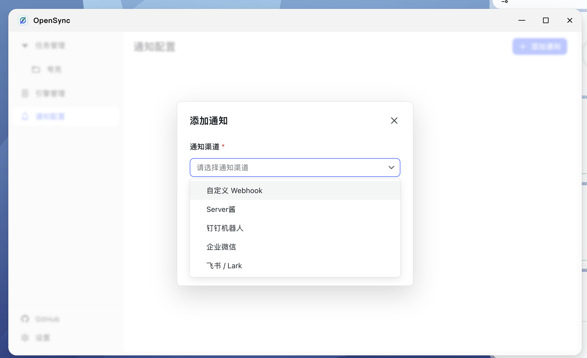

<div align="center">

# OpenSync

**飞牛 NAS 上的自动同步与备份工具**

把 NAS、网盘和 WebDAV 之间的文件同步交给它：定时执行、进度可见、结果有通知。

群晖 Cloud Sync 的免费开源替代方案

[](https://github.com/chenbin3625/OpenSync-fnOS/releases)
[](https://github.com/chenbin3625/OpenSync-fnOS/releases)
[](LICENSE)

当前版本：**v0.0.38**

[下载安装](https://github.com/chenbin3625/OpenSync-fnOS/releases/latest) · [快速上手](#快速上手) · [常见问题](#常见问题)

</div>

OpenSync 是一款运行在飞牛 fnOS 上的文件同步与备份应用。它借助 **OpenList（兼容 AList）** 连接你的本地磁盘、网盘和 WebDAV 等存储，再按你设定的时间，自动把文件从源目录复制、镜像或移动到目标目录。

所有同步配置都在图形界面完成，不需要写脚本：在 OpenList 里添加好存储，在 OpenSync 里填上地址和 Token，再建一个任务，第一次备份就可以跑起来了。

> **一句话理解**：OpenSync 决定「什么时候、把哪些文件、从哪同步到哪」，真正的读写由 OpenList 完成。

## 目录

- [它能做什么](#它能做什么)
- [功能一览](#功能一览)
- [安装](#安装)
- [快速上手](#快速上手)
- [同步模式怎么选](#同步模式怎么选)
- [文件过滤](#文件过滤)
- [任务状态与通知](#任务状态与通知)
- [系统设置](#系统设置)
- [常见问题](#常见问题)
- [更新与反馈](#更新与反馈)

## 它能做什么

- **照片和视频备份** —— 把 NAS 上的相册目录每天自动备份到阿里云盘、百度网盘或 OneDrive，多一份云端保险。
- **重要资料容灾** —— 工作文档、家庭资料定时镜像到另一块硬盘或另一个网盘，硬盘坏了也不慌。
- **网盘搬家** —— 把旧网盘的文件搬到新网盘，确认复制成功且内容校验无误后，再删除源文件。
- **多端保持一致** —— 让目标目录和源目录完全一致，源端删掉的文件，目标端也会同步删除。
- **执行结果随时掌握** —— 成功、部分失败、失败都会推送通知，不用天天盯着进度条。

适合这些用户：

- 有飞牛 NAS，想给重要数据多做一份云端备份；
- 文件散落在多个网盘，想集中整理和搬运；
- 习惯群晖 Cloud Sync 的用法，希望在飞牛上找到同类工具；
- 不想折腾脚本，只想在图形界面里点几下完成配置。

## 功能一览

| 能力 | 说明 |
| --- | --- |
| 三种同步方式 | 增量同步、全量同步、移动 |
| 灵活定时 | 固定间隔、Cron 表达式、仅手动触发 |
| 文件过滤 | 按大小、类型、文件夹和系统目录过滤 |
| 实时进度 | 传输速度、已完成大小、运行时间、逐文件状态 |
| 执行历史 | 按日期、状态、类型、关键词筛选，失败项可重试 |
| 多渠道通知 | 钉钉、企业微信、飞书、Server酱、Bark、自定义 Webhook |
| 数据安全 | 全量删除保护、移动校验后删源、Token 加密保存 |

## 安装

### 安装前准备

- 飞牛 fnOS **1.2.0401 或更高版本**；
- 已安装并运行 **OpenList**（或 AList），并在其中至少添加了一个存储；
- OpenSync 所在设备能够访问 OpenList 的地址。

> 如果还没有 OpenList，可以先参考 [OpenList 项目](https://github.com/OpenListTeam/OpenList) 完成安装。OpenList 支持的本地磁盘、S3、WebDAV、阿里云盘、百度网盘、OneDrive 等存储，都可以直接在 OpenSync 中使用。

### 下载安装包

| 设备架构 | 安装包 |
| --- | --- |
| x86 / amd64（Intel、AMD） | [opensync-amd64.fpk](https://github.com/chenbin3625/OpenSync-fnOS/releases/latest/download/opensync-amd64.fpk) |
| ARM / arm64 | [opensync-arm64.fpk](https://github.com/chenbin3625/OpenSync-fnOS/releases/latest/download/opensync-arm64.fpk) |

不确定设备架构？在飞牛的系统信息中查看处理器型号：Intel、AMD 选 amd64，ARM 处理器选 arm64。也可以前往 [Releases](https://github.com/chenbin3625/OpenSync-fnOS/releases) 查看全部版本。

### 安装步骤

1. 在飞牛中打开「应用中心」，选择「手动安装」，上传下载好的 `.fpk` 文件。
2. 等待安装完成，在应用列表中找到 **OpenSync** 并打开。
3. 首次使用可在应用设置中按需配置访问目录；如果使用本地目录作为存储，还需要确保 OpenList 对该目录有读写权限。

安装包同时提供 `SHA256SUMS` 校验文件，熟悉命令行的用户可以自行校验完整性。

## 快速上手

下面以「把 NAS 上的照片备份到网盘」为例，第一次配置大约需要 5 分钟。

### 第 1 步：在 OpenList 中准备好存储

1. 打开 OpenList 后台，默认地址通常是 `http://你的NAS地址:5244`。
2. 进入「存储管理」→「添加存储」。
3. 添加**源端**：选择「本地存储」，挂载 NAS 上要备份的目录（例如照片文件夹）。
4. 添加**目标端**：选择你的网盘（如阿里云盘、百度网盘、OneDrive），完成授权。
5. 分别打开两个存储，确认都能正常看到文件。
6. 进入「设置」→「其他」，复制 **API Token** 备用。

### 第 2 步：在 OpenSync 中添加引擎

1. 打开 OpenSync，进入「引擎管理」。
2. 点击「添加引擎」，填写：
   - **引擎名称**：随意填写，例如「我的 NAS」；
   - **引擎地址**：OpenList 的访问地址，例如 `http://192.168.1.10:5244`；
   - **API Token**：第 1 步复制的 Token。
3. 保存后点击「测试引擎」，提示连接正常即可。

<p align="center">
  
</p>

> OpenList 和 OpenSync 装在同一台飞牛上时，引擎地址也可以尝试 `http://127.0.0.1:5244`；如果不通，改用 NAS 的局域网 IP。

### 第 3 步：新建同步任务

进入「任务管理」，点击「新建任务」，按四个步骤配置：

1. **引擎与路径** —— 选择刚添加的引擎，指定源目录和目标目录。支持多个源目录和目标目录，但源目录与目标目录不能相同或互相包含，多个源目录之间也不能互相包含。
2. **同步与调度** —— 选择同步方式（增量同步 / 全量同步 / 移动）和执行计划（固定间隔 / Cron / 仅手动）。
3. **文件过滤** —— 按需设置文件大小范围，并勾选要排除的文件类型。
4. **文件夹过滤** —— 勾选源目录下要忽略的子文件夹，以及 macOS、Windows、NAS 回收站等系统目录。

保存后，任务会按计划自动执行。

> 不熟悉 Cron？调度方式选「间隔(分钟)」即可，例如填 `60` 表示每小时执行一次。需要「每天凌晨 3 点」这类固定时间时再选 Cron，编辑器会显示每个字段的含义和下次执行时间。

### 第 4 步：先手动跑一次

建议第一次先手动执行，确认路径和过滤规则符合预期：

1. 在任务「总览」中点击「立即执行」。
2. 切换到「实时任务」查看进度、速度和逐文件状态。
3. 执行完成后，在「历史任务」中核对成功和失败的文件数量。

<p align="center">
  
</p>

<p align="center">
  
</p>

<p align="center">
  
</p>

### 第 5 步：配置通知（可选）

进入「通知配置」，添加你常用的通知渠道，填写必要参数后点击「测试」确认能收到消息。之后任务执行结束，结果会自动推送到对应渠道。

<p align="center">
  
</p>

## 同步模式怎么选

| 模式 | 一句话说明 | 目标端多余文件 | 源文件 | 推荐场景 |
| --- | --- | --- | --- | --- |
| **增量同步** | 只复制新增和内容变化的文件 | 保留 | 保留 | 日常备份 |
| **全量同步** | 让目标目录与源目录完全一致 | 删除（有保护） | 保留 | 镜像、容灾 |
| **移动** | 复制并校验成功后删除源文件 | — | 校验后删除 | 网盘搬家、腾空间 |

### 增量同步

只复制源目录中目标端不存在或内容发生变化的文件，不会删除目标端的任何文件。适合「源端删了文件，但网盘里还想保留一份」的日常备份场景。

这是最稳妥的模式，建议第一次使用、或不确定该选什么时，先从增量同步开始。

### 全量同步

让目标目录与源目录保持完全一致，目标端多出来的文件会被删除。源文件只是改名或换了目录时，会尽量复用目标端已有的相同内容，避免重复上传。

全量同步会等本次新增和更新的文件写入成功后，再清理目标端多余项。当计划删除量异常偏大，或目录扫描结果不完整时，会跳过清理并记录失败。同路径的文件和目录需要先解决类型冲突；如果冲突涉及被排除的目标内容，则保留原内容并报告失败。第一次切换到全量同步前，仍建议先手动执行一次，确认文件列表无误。

### 移动

先把文件复制到目标目录，确认目标文件存在且大小一致、源文件在复制期间没有变化（两端都提供 MD5 时还会比对 MD5），才会删除源文件。适合把文件从一个网盘搬到另一个网盘，或从系统盘挪到数据盘。

移动完成后会保留空源目录，被过滤掉的文件也不会被删除。

> **移动模式注意事项**
>
> - 只能设置一个目标目录；
> - 不要使用指向同一份数据的别名、重复挂载或软链接；
> - 移动过程中不要修改两端的文件；
> - 引擎账号需要具备两端目录刷新、目标复制和源文件删除权限；
> - 缺少 MD5 时，大小和修改时间相同并不能 100% 证明内容逐字节一致。有并发写入需求时，建议先使用增量同步并人工验收。

## 文件过滤

被过滤掉的源文件不会复制；全量同步也不会删除或覆盖被过滤掉的目标内容。即使目标父目录只在目标端存在，清理时也会保留其中被排除的文件和目录。相关设置位于任务编辑器的「文件过滤」和「文件夹过滤」中。

### 按大小过滤

可以分别设置「排除小于」和「排除大于」的文件大小，例如跳过 10 KB 以下的缩略图和 10 GB 以上的超大文件。

### 按文件类型过滤

界面内置了常用分组，勾选即可排除：

- 系统文件：`.DS_Store`、`._*`、`Thumbs.db`、`Desktop.ini` 等；
- 音乐、视频、图像、文档、压缩文件、可执行文件等常见类型。

也可以在「其他」中添加自定义规则，支持简单的 `*` 通配符：

| 规则 | 作用 |
| --- | --- |
| `Thumbs.db` | 忽略所有同名文件 |
| `._*` | 忽略以 `._` 开头的文件 |
| `*.tmp` | 忽略所有 `.tmp` 后缀的文件 |

> 自定义输入只支持文件名和后缀规则，不支持 `!` 反选、字符集、正则表达式等复杂语法，保存时会提示并拒绝不支持的写法。需要忽略文件夹时，请使用下面的「文件夹过滤」。

### 按文件夹过滤

在「文件夹过滤」中展开源目录树，勾选要忽略的子文件夹即可。规则只针对源目录，未勾选的文件夹会正常同步。

### 系统目录过滤

一键忽略常见的系统和 NAS 目录，包括：

- macOS：`.Spotlight-V100/`、`.Trashes/`、`.fseventsd/` 等；
- Windows：`$RECYCLE.BIN/`、`System Volume Information/`；
- NAS 回收站：`#recycle/`、`@Recycle/`、`.Trash/` 等；
- 其他：`lost+found/`、`@eaDir/` 等。

## 任务状态与通知

### 三种查看视图

- **总览** —— 查看任务的引擎、路径、模式和下次执行时间；可以立即执行、停止当前任务、停用任务或编辑配置。
- **实时任务** —— 查看正在执行的任务进度，包括传输速度、已完成大小、运行时间和逐文件状态。页面会定期刷新，切换状态或分页时立即加载。
- **历史任务** —— 按日期范围、状态或任务 ID 筛选执行记录。运行中可点击「查看实时进度」跳转，已结束可查看逐文件明细并按操作类型、对象类型或关键词筛选。

任务状态包括：等待中、运行中、成功、部分失败、失败、已停止、超时、系统错误和无需同步。出现「部分失败」时，可以在历史记录中点击「重试未完成项」。文件失败项可以直接重试；目录失败项会重新扫描对应的源目标目录并比较文件。重试不会重放旧删除，也不会在全量重扫时清理目标端；需要镜像清理时，请重新执行全量同步。

### 通知渠道

| 渠道 | 适合场景 | 需要准备 |
| --- | --- | --- |
| 钉钉机器人 | 家庭群、团队群 | Webhook 地址，可选加签密钥 |
| 企业微信 | 企业微信群 | 群机器人 Webhook 地址 |
| 飞书 / Lark | 团队群 | Webhook 地址，可选签名密钥 |
| Server酱 | 微信推送 | SendKey |
| Bark | iPhone 推送 | Device Key，可自建服务器 |
| 自定义 Webhook | 接入自建服务或自动化平台 | URL，支持 GET / POST / PUT |

添加通知后可以先点「测试」确认配置正确。通知是异步发送的，发送失败不会影响任务本身；通知列表会显示最近一次的投递状态。通知内容只包含任务状态、源/目标路径、成功/失败数量、耗时和大小等摘要，不会发送文件内容。

## 系统设置

在「设置」页面可以调整任务执行参数：

| 设置项 | 默认值 | 说明 | 调整建议 |
| --- | --- | --- | --- |
| 操作并发数 | 5 | 同时执行的复制、删除、移动操作数量 | 网盘限速或频繁失败时调低 |
| 扫描并发数 | 16 | 同时扫描源端和目标端目录的请求数量 | 大目录或接口不稳定时调低 |
| 失败重试次数 | 2 | 单个文件操作失败后的最大重试次数 | 网络不稳定时可调到 3–5 |
| 任务超时 | 48 小时 | 任务超过该时长后自动标记为超时 | 首次超大同步可调高，`0` 表示不限制 |
| 任务记录保留 | 30 天 | 历史任务记录保留天数 | `0` 表示不自动清理 |

<p align="center">
  
</p>

## 常见问题

### 必须安装 OpenList 吗？能不能直接连网盘？

需要安装。OpenSync 依赖 OpenList / AList 作为存储引擎，本身不直接对接网盘。好处是只要 OpenList 支持的存储——本地磁盘、S3、WebDAV、阿里云盘、百度网盘、OneDrive 等——都能直接在 OpenSync 里使用，具体支持范围以你使用的 OpenList 版本为准。

### 在 OpenList 里添加的目录，为什么 OpenSync 里看不到文件？

先在 OpenList 后台确认该目录能正常浏览。如果是本地目录，还需要运行 OpenList 的用户或容器对该目录有读写权限。刚添加存储时，可以在任务编辑器里刷新一下目录树。

### 全量同步会不会误删我的文件？

全量同步确实会删除目标端多余的文件，但内置了删除保护：当计划删除量异常偏大，或目录扫描不完整时，会自动跳过删除并记录失败。第一次使用建议先手动执行一次，核对文件列表后再放心交给计划任务。

### 移动模式安全吗？

移动会先复制，再校验目标文件大小、源文件大小和修改时间（两端支持时还会比对 MD5），确认无误后才删除源文件；校验不通过会保留源文件并报告失败。请只设置一个目标目录，不要使用指向同一份数据的别名或软链接，也不要在移动期间修改两端文件。

### 同步速度慢怎么办？

速度主要取决于 OpenList 所在设备的上行带宽、源端和目标端网盘的限速与接口，以及任务的操作并发数。可以尝试适当降低操作并发，避免触发网盘限流；跨网盘同步通常需要先下载再上传，速度会受两端共同影响。

### 任务失败了怎么办？

先到「任务管理 → 历史任务」查看失败原因。常见原因包括 Token 失效、目录权限不足、网盘限流或网络超时。修复后点击「重试未完成项」即可，只处理未完成的文件，已完成的部分不会重复复制。配置了通知的话，任务结束时也会收到结果提醒。

### 任务运行中可以停止吗？

可以。在任务「总览」中点击「停止」只会中止当前这次执行；关闭任务开关则会停用计划并中止当前执行。已经完成的文件不会回滚或撤销。

### 升级会丢失配置和任务吗？

不会。使用新版本安装包覆盖升级会保留引擎、任务、通知和历史记录，升级前应用还会自动备份数据。升级过程会自动停止并重新启动应用。

### 卸载会删除我同步的文件吗？

不会。卸载只会移除 OpenSync 应用本身，不会删除源目录或目标目录里的文件。应用配置和历史记录保存在飞牛的应用数据目录中，是否保留以飞牛卸载时的提示为准。

### 支持双向同步吗？

目前只支持单向同步（源 → 目标）。如果需要反向备份，可以另外创建一个任务，但不要把两个目录互设为全量同步的源和目标，以免两边互相删除文件。

### 会收集我的隐私数据吗？

不会上传你的文件或网盘账号信息。引擎 Token 等敏感内容会加密保存在本机；应用只会访问 GitHub 查询公开的最新版本号，以及按你的配置发送任务通知。

## 更新与反馈

### 检查更新

应用会自动查询 GitHub 上的最新正式版本（成功结果缓存 30 分钟）。发现新版本时，版本号旁会出现蓝色升级图标，右上角也会弹出可点击的提醒，点击即可前往 Releases 下载新安装包。

### 问题反馈

遇到问题欢迎到 [GitHub Issues](https://github.com/chenbin3625/OpenSync-fnOS/issues) 反馈。提交时请附上：

- OpenSync 版本号；
- 任务名称和错误提示；
- 如果方便，附上应用数据目录下的 `app.log` 日志。

### 许可证

本项目基于 [MIT License](LICENSE) 开源。

<details>
<summary>本地开发与打包（开发者）</summary>

```bash
npm run dev        # 启动 Go 后端和 Vite 前端
npm run dev:mock   # 仅调试前端，使用内置 mock 数据
npm run package:amd64
npm run package:arm64
```

技术栈：React 19 + TypeScript + Vite + Semi Design，后端 Go + Gin + SQLite，使用 robfig/cron 调度，按 fnOS Native App 规范打包。

</details>
